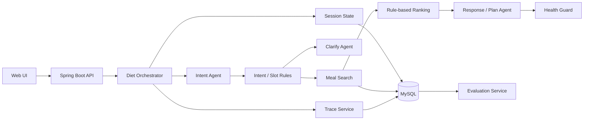

# Oiishi — 可评估、可追踪的多 Agent 饮食推荐助手

> 个人全栈 AI 应用项目：用工程化方式解决多轮饮食推荐中的意图理解、信息澄清、候选检索、结果解释、安全控制与效果评估问题。

Oiishi 不是一次 Prompt 调用包装出的聊天页面。项目将推荐过程拆分为多个职责明确的 Agent，并由状态机式 Orchestrator 统一编排；同时补齐了会话持久化、规则降级、链路追踪、人工标注与离线评估能力，让 LLM 应用的行为可以观察、解释和持续改进。

## 项目速览

| 维度 | 内容 |
| --- | --- |
| 项目定位 | 面向日常场景的多轮餐食推荐与多餐规划助手 |
| 核心问题 | 用户表达不完整、模型输出不稳定、推荐依据不可追踪、效果难评估 |
| 技术方案 | 多 Agent 编排 + 会话状态机 + 检索重排 + 安全守卫 + Trace/Evaluation |
| 技术栈 | Java 21、Spring Boot 3.3、AgentScope、MyBatis、MySQL 8、原生 Web |
| 工程规模 | 80 个 Java 文件、7 个业务 Controller、29 个 Service/Component、5 套 Agent Prompt、6 张数据表 |
| 我的工作 | 独立完成需求抽象、系统设计、后端与 Agent 编排、数据库、Web 页面、可观测与评估模块 |

## 为什么做这个项目

“今天吃什么”看似简单，实际包含一组适合验证 Agent 工程能力的问题：

- 用户通常只说“想吃清淡一点”，必要信息并不完整；
- 推荐需要结合餐次、心情、场景、健康目标、菜系和便捷性等多维约束；
- 用户会连续提出“换一批”“再快一点”等基于上下文的调整；
- LLM 可能输出非法字段、错误格式，或者给出不安全的健康建议；
- 如果没有 Trace 和评估指标，很难判断一次推荐为什么成功或失败。

因此，我把这个项目设计成一条可解释、可降级、可评估的 Agent Workflow，而不是把所有职责塞进一个 Prompt。

## 核心能力

### 1. 多 Agent 分工与状态机编排

- `IntentAgent`：识别推荐、调整、多餐规划、健康风险等意图并提取槽位；
- `ClarifyAgent`：在关键信息不足时生成最小必要追问；
- `RecommendResponseAgent`：根据重排结果生成推荐理由和自然语言回复；
- `PlanResponseAgent`：组织早餐、午餐、晚餐等多餐计划；
- `EvaluationJudgeAgent`：从解释质量和自然度等维度参与离线评估；
- `DietOrchestratorService`：负责会话加锁、状态流转、Agent 调用、路由和结果落库。

系统显式维护 `START → CLARIFY → RECOMMEND / PLAN` 会话阶段，并保留历史槽位与上轮推荐结果，使“换一批”“清淡一点”等后续表达可以基于上下文执行。

### 2. LLM 与确定性规则协作

项目没有把所有判断都交给模型：

- LLM 负责语义理解、自然语言澄清与推荐解释；
- 规则层负责低置信度校正、槽位合法性过滤、缺失字段判断和候选重排；
- Agent 超时、JSON 解析失败或结果不合法时，自动回退关键词与规则链；
- 推荐卡片只能来自数据库候选，降低模型凭空生成餐食的风险。

这种设计在表达能力与流程稳定性之间取得平衡，也让关键业务约束能够被测试和审计。

### 3. 推荐检索与重排

- 支持 `PERSONAL` 个人餐食库与 `PUBLIC` 公共餐食库；
- 按用户槽位从 MySQL 召回候选；
- 根据槽位命中进行二次打分和排序；
- 调整场景会排除上轮已推荐餐食，避免重复；
- 多餐规划会按餐次拆分检索，再由 Agent 统一组织回复。

### 4. 健康与合规守卫

在意图层和最终回复层进行双重检查，识别医疗诊断、治疗承诺、极端节食、绝对化减肥承诺及特殊人群风险。命中规则后，系统会替换为保守提示，而不是直接返回高风险内容。

### 5. 全链路 Trace 与离线评估

每轮请求生成唯一 `traceId`，记录：

- 意图识别与规则修正；
- 槽位合并与澄清决策；
- 检索、重排及最终候选；
- Agent 名称、模型、输入输出、耗时与 Token 用量；
- 安全守卫结果、异常和回退状态。

评估模块支持人工标注意图、槽位和澄清动作，并统计意图准确率、槽位准确率、澄清必要性、延迟、Token 成本、回退率、安全合规、幻觉控制、多轮一致性、用户反馈及 LLM Judge 分数。

## 系统架构



一轮推荐请求的核心链路：

```text
加载会话 → 创建 Trace → 意图识别 → 规则校正 → 槽位合并
    → 信息不足：澄清追问
    → 信息充分：候选召回 → 规则重排 → Agent 解释
    → 安全守卫 → 状态/消息/Trace 落库 → 返回响应
```

## 关键技术设计

### 用显式状态替代隐式对话记忆

会话阶段、结构化槽位和上次推荐结果持久化到数据库。Agent 每轮只接收必要历史摘要，减少上下文污染和 Token 消耗，也避免把业务状态完全寄托在模型记忆中。

### 用 Schema 与候选字典约束模型输出

Agent 输出先从文本中提取 JSON，再映射为强类型模型；槽位值必须通过数据库候选字典校验。格式异常或非法值不会直接进入后续业务链路。

### 用 Session 级锁保护状态一致性

同一 `sessionId` 的请求串行执行，避免并发写入造成历史槽位、推荐结果和消息顺序错乱；不同会话仍可并行处理。

### 将评估能力放进系统设计

Trace 不是普通日志，而是后续评估的数据源。项目从设计阶段就记录模型调用、业务决策和最终候选，使规则指标、人工标注、用户反馈和 LLM Judge 可以在同一条请求链路上对齐。

## Web 功能

- 多轮聊天推荐与澄清交互；
- 个人餐食增删改查；
- 公共餐食浏览；
- Trace 列表与单链路事件查看；
- Trace 人工标注意图、槽位和澄清动作；
- 按时间范围执行综合评估并查看指标。

## 主要接口

| 方法 | 路径 | 用途 |
| --- | --- | --- |
| `POST` | `/api/v1/diet/chat` | 多轮推荐、调整与规划 |
| `POST` | `/api/v1/diet/sessions` | 创建会话 |
| `GET/POST/PUT/DELETE` | `/api/v1/diet/meals/personal` | 管理个人餐食 |
| `GET` | `/api/v1/diet/meals/public` | 查询公共餐食 |
| `POST` | `/api/v1/diet/feedback` | 提交推荐反馈 |
| `GET/PUT` | `/api/v1/diet/debug/traces...` | 查询及标注 Trace |
| `POST` | `/api/v1/diet/evaluations` | 执行离线评估 |

## 本地运行

### 环境要求

- JDK 21
- Maven 3.9+
- MySQL 8.x
- DashScope API Key

### 1. 初始化数据库

```bash
mysql -u <用户名> -p -e "CREATE DATABASE IF NOT EXISTS diet_db CHARACTER SET utf8mb4"
mysql -u <用户名> -p diet_db < src/main/resources/db/diet_db.sql
```

脚本会创建所需数据表，并写入公共餐食和槽位字典演示数据。

### 2. 配置环境变量

```bash
export DB_USERNAME='<数据库用户名>'
export DB_PASSWORD='<数据库密码>'
export DASHSCOPE_API_KEY='<DashScope API Key>'
```

可选配置：

| 环境变量 | 默认值 | 说明 |
| --- | --- | --- |
| `DB_URL` | `jdbc:mysql://localhost:3306/diet_db...` | JDBC 地址 |
| `SERVER_PORT` | `8080` | 服务端口 |
| `DIET_MAIN_MODEL` | `qwen-max` | 推荐与规划模型 |
| `DIET_LIGHT_MODEL` | `qwen-turbo` | 意图与澄清模型 |
| `DIET_MAX_HISTORY_TURNS` | `10` | 最大历史轮数 |
| `DIET_LOG_LEVEL` | `INFO` | 项目日志级别 |

### 3. 启动

```bash
mvn spring-boot:run
```

浏览器访问 <http://localhost:8080>。

## 项目结构

```text
src/main/java/com/diet/
├── agent/          # Agent Builder、Factory 与 Prompt 加载
├── controller/     # 推荐、餐食、Trace、反馈和评估 API
├── service/
│   ├── orchestrator/   # Agent 工作流与会话路由
│   ├── intent/         # 意图识别与规则修正
│   ├── clarify/        # 澄清决策与兜底
│   ├── meal/           # 餐食检索、重排和 CRUD
│   ├── recommend/      # 推荐回复生成
│   ├── plan/           # 多餐规划
│   ├── risk/           # 健康风险守卫
│   ├── trace/          # 全链路事件记录
│   └── evaluation/     # 规则指标与 LLM Judge
├── mapper/         # MyBatis Mapper
└── model/          # 请求、响应及领域模型

src/main/resources/
├── db/             # 表结构与演示种子数据
├── diet/prompts/   # Agent Prompt
├── mapper/         # MyBatis XML
└── static/         # 原生 Web 前端
```

## 当前边界与下一步

当前版本定位为可本地运行的个人项目，重点验证 Agent Workflow、可观测和评估闭环。后续计划包括：

- 增加自动化测试与标准化评测数据集；
- 将 Session 锁从进程内方案演进为适配多实例部署的分布式方案；
- 增加认证授权，隔离不同用户的餐食与 Trace 数据；
- 引入缓存和异步任务，优化长链路延迟；
- 补充 Docker Compose 与 CI/CD，降低演示和部署成本。

## 安全说明

项目不在代码中保存数据库密码或模型服务密钥，运行凭据必须通过环境变量注入。`.env`、本地配置、日志、证书和私钥均已加入忽略规则。

> 本项目提供一般性的餐食推荐，不构成医疗诊断、治疗或个体化营养处方。
